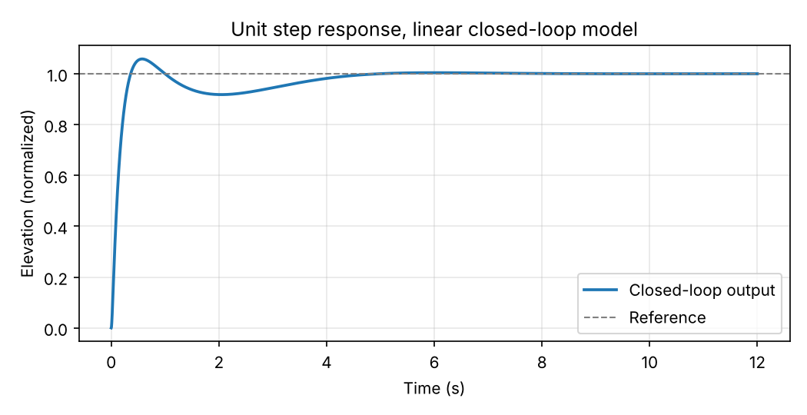

# Filtered PID Controller for a 3DOF Helicopter Elevation System

Design and tuning of a filtered PID controller that makes a 3-degree-of-freedom helicopter follow an elevation path and recover from a 2-second motor blackout without crashing.

Course project for Control Engineering (CE-1542), Taif University, 2026.

## The problem

The helicopter has to track a 120-second reference path with steps, cruise phases, and a parabolic landing ramp. At t = 65 s the motors cut out for 2 seconds. The controller has to bring the helicopter back to cruise altitude quickly while keeping the control voltage inside the ±10 V actuator limits.

Design goals:

| Goal | Approach |
| --- | --- |
| Zero steady-state error | Type-1 loop with a pure integrator |
| 5% overshoot target | Damping ratio ζ = 0.6901 |
| Recovery in under 5 s after the blackout | Third pole placed at s = -5 |
| Sensor noise attenuation | Low-pass filter, τ = 0.012 s |
| Actuator protection | Control voltage kept within ±10 V |

## Design

Plant model:

```
P(s) = 0.1675 / (s^2 + 0.09525 s + 1.613)
```

The gains come from matching the closed-loop characteristic equation to

```
(s^2 + 2 ζ ωn s + ωn^2)(s + α)
```

with ζ = 0.6901, ωn = 1.1 rad/s and α = 5.0, which gives:

| Kd | Kp | Ki |
| --- | --- | --- |
| 38.3461 | 42.9140 | 36.1194 |

Filtered PID controller:

```
Gc(s) = (38.3461 s^2 + 42.9140 s + 36.1194) / (s (0.012 s + 1))
```

Closed-loop transfer function:

```
T(s) = (6.4230 s^2 + 7.1881 s + 6.0500) / (0.012 s^4 + 1.0011 s^3 + 6.5376 s^2 + 8.8011 s + 6.0500)
```

## Tuning history

Each trial was scored with the course cost function J (lower is better), which adds a penalty if the helicopter hits the ground.

| Trial | ωn | α | Cost J | What happened |
| --- | --- | --- | --- | --- |
| 1 | 2.0 | 10.0 | 105.31 | Gains too high, voltage saturated, integrator windup, crash |
| 2 | 1.1 | 3.3 | 3.03 | No saturation, no crash, recovery too slow |
| 3 | 1.1 | 4.0 | 2.55 | Faster recovery, lower tracking error |
| 4 | 1.1 | 5.0 | 2.11 | Final design, filter tightened to τ = 0.012 s |

## Results

- Final cost J = 2.11345 with zero crash penalty
- Recovered from the blackout without reaching the -0.488 rad crash threshold
- Control voltage stayed within ±10 V

Step response of the linear closed-loop model:



The full tracking plots from the Simulink run are in the [report](docs/report.pdf).

## Files

| File | What it is |
| --- | --- |
| `pid_design.m` | Computes the gains, builds the closed loop, and plots the step response |
| `helicopter_pid_filtered.m` | Original run script: simulates the 120 s flight in Simulink and evaluates the cost J |
| `docs/report.pdf` | Project report with the full simulation results |
| `figures/step_response.png` | Step response of the linear model |

The Simulink helicopter model (`helicopter_ver19g`) and the cost function (`cf.m`) were provided by the course and are not included here.

## Running it

Open `pid_design.m` in MATLAB (Control System Toolbox required) and run it. It works on its own.

`helicopter_pid_filtered.m` needs the course Simulink model and `cf.m` in the same folder.

## What I learned

- A faster controller is not always a better one. Past a point, higher gains push the actuator into saturation and performance gets worse.
- Integrator windup is what caused the crash in Trial 1. The integrator kept accumulating error while the output was capped, then released it all at once.
- The third pole α is a useful knob for disturbance rejection. Too small and recovery is slow, too large and the actuator saturates.

## Author

Reema Khalid Al-boqami, Computer Engineering, Taif University
